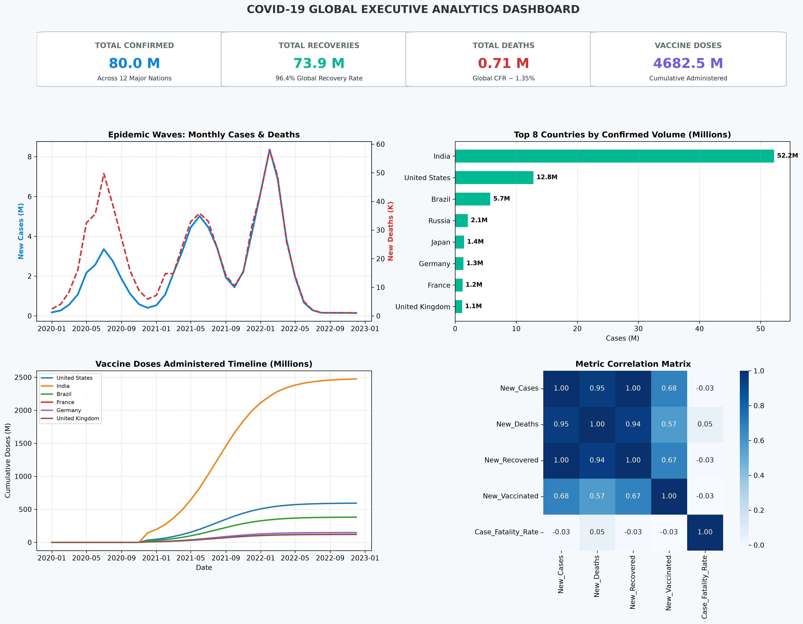
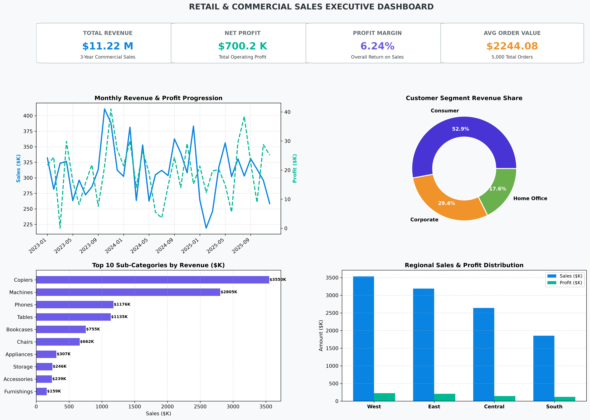

# Mini Projects on Data Analytics and Visualization
### Master of Computer Applications (MCA) — III Semester | Session 2026–2027
**Lab Sheet-09: Mini Projects on Data Analytics and Visualization**

[](https://www.python.org/)
[](https://pandas.pydata.org/)
[](https://plotly.com/python/)
[](datasets/)

---

## 📌 Executive Overview

This repository contains the complete implementation, datasets in Excel format, high-resolution dashboard screenshots, interactive web dashboards, and source code for **Lab Sheet-09: Mini Projects on Data Analytics and Visualization**.

The repository comprises two end-to-end analytical projects:

1. **Project 1: COVID-19 Data Analysis Dashboard**
   - Comprehensive analysis of global epidemiological time-series data across 12 countries over 36 months (2020–2022).
   - Missing value auditing and proportional domain-specific imputation.
   - Dual-axis epidemic wave curves (New Cases vs. New Deaths).
   - Country-wise comparative rankings, mortality rates (Case Fatality Rate - CFR), and vaccination rollout tracking.
   - High-resolution Executive Dashboard Screenshot and browser-based Interactive Plotly Dashboard.

2. **Project 2: Sales Data Analysis Dashboard**
   - Analysis of multi-regional commercial sales transactions (5,000 orders spanning 2023–2025).
   - Missing value detection and mode/baseline imputation.
   - Monthly sales revenue and net operating profit progression analysis.
   - Customer segmentation (Consumer, Corporate, Home Office).
   - Product category and sub-category profitability analysis (identifying profit leaders vs. loss leaders).
   - Regional distribution breakdown (West, East, Central, South).
   - High-resolution Executive Sales Dashboard Screenshot and browser-based Interactive Plotly Dashboard.

---

## 📋 Submission Guidelines Compliance Checklist

| Mandatory Submission Requirement | Delivered Repository Asset | Format & Description |
|:---|:---|:---:|
| **1. Datasets in Excel Form** | [`datasets/covid_19_data.xlsx`](datasets/covid_19_data.xlsx)<br>[`datasets/sales_data.xlsx`](datasets/sales_data.xlsx) | **Multi-Sheet Microsoft Excel (`.xlsx`)** workbooks with raw data, cleaned data, and multi-dimensional summary sheets. |
| **2. Datasets in CSV Form** | [`datasets/covid_19_data.csv`](datasets/covid_19_data.csv)<br>[`datasets/sales_data.csv`](datasets/sales_data.csv) | Standard `.csv` |
| **3. Dashboard Screenshots** | [`Project1_COVID19_Data_Analysis/screenshots/covid19_executive_dashboard.png`](Project1_COVID19_Data_Analysis/screenshots/covid19_executive_dashboard.png)<br>[`Project2_Sales_Data_Analysis/screenshots/sales_executive_dashboard.png`](Project2_Sales_Data_Analysis/screenshots/sales_executive_dashboard.png) | **300 DPI High-Resolution Executive Dashboard Screenshots** |
| **4. Source Code** | [`Project1_COVID19_Data_Analysis/src/`](Project1_COVID19_Data_Analysis/src/)<br>[`Project2_Sales_Data_Analysis/src/`](Project2_Sales_Data_Analysis/src/) | Modular Python Scripts (Data loader, EDA, Dashboard generator) |
| **5. Interactive Web Dashboards** | [`Project1_COVID19_Data_Analysis/outputs/covid_interactive_dashboard.html`](Project1_COVID19_Data_Analysis/outputs/covid_interactive_dashboard.html)<br>[`Project2_Sales_Data_Analysis/outputs/sales_interactive_dashboard.html`](Project2_Sales_Data_Analysis/outputs/sales_interactive_dashboard.html) | Standalone interactive **Plotly HTML dashboards** with tooltips and zooming |
| **6. Jupyter Notebooks** | [`Project1_COVID19_Data_Analysis/notebooks/Project1_COVID19_Data_Analysis.ipynb`](Project1_COVID19_Data_Analysis/notebooks/Project1_COVID19_Data_Analysis.ipynb)<br>[`Project2_Sales_Data_Analysis/notebooks/Project2_Sales_Data_Analysis.ipynb`](Project2_Sales_Data_Analysis/notebooks/Project2_Sales_Data_Analysis.ipynb) | Interactive step-by-step `.ipynb` notebooks |

---

## 📊 Dashboard Visualizations & Screenshots

### 1. COVID-19 Executive Analytics Dashboard


- **Interactive HTML Dashboard:** Open [`Project1_COVID19_Data_Analysis/outputs/covid_interactive_dashboard.html`](Project1_COVID19_Data_Analysis/outputs/covid_interactive_dashboard.html) in any browser.
- **Key Global Epidemiological Metrics:**
  - **Total Confirmed Infections:** 80,006,448
  - **Total Deaths:** 705,994 (Global CFR: 0.88%)
  - **Total Recovered:** 73,900,724 (Global Recovery Rate: 92.37%)
  - **Cumulative Vaccines Administered:** 4,682,484,804 doses

---

### 2. Commercial Sales & Retail Performance Dashboard


- **Interactive HTML Dashboard:** Open [`Project2_Sales_Data_Analysis/outputs/sales_interactive_dashboard.html`](Project2_Sales_Data_Analysis/outputs/sales_interactive_dashboard.html) in any browser.
- **Key Financial Metrics:**
  - **Total Commercial Revenue:** $11,220,417.57
  - **Net Operating Profit:** $700,155.23
  - **Overall Gross Margin:** 6.24%
  - **Average Order Value (AOV):** $2,244.08 (across 5,000 orders)

---

## 📁 Multi-Sheet Excel Dataset Structure

### 1. [`datasets/covid_19_data.xlsx`](datasets/covid_19_data.xlsx)
- `Sheet 1: Raw_Recorded_Data` — Original recorded time-series containing uncleaned/missing entries.
- `Sheet 2: Cleaned_Data` — Fully cleaned, imputed, and feature-engineered dataset (CFR, Recovery Rate, Active Cases).
- `Sheet 3: Country_Summary` — Latest cumulative statistics, rankings, and vaccination rates per country.
- `Sheet 4: Global_Timeline` — Monthly aggregated global progression.

### 2. [`datasets/sales_data.xlsx`](datasets/sales_data.xlsx)
- `Sheet 1: Raw_Orders_Data` — Raw transactional records with uncleaned nulls.
- `Sheet 2: Cleaned_Orders` — Cleaned orders with calculated profit margins and shipping days.
- `Sheet 3: Monthly_Trends` — 36-month revenue, profit, quantity, and order count aggregations.
- `Sheet 4: Customer_Segmentation` — Segment revenue, profit, and order distributions.
- `Sheet 5: Product_Performance` — Category & Sub-Category profit margins and unit volumes.
- `Sheet 6: Regional_Summary` — Regional and State-level sales and profit performance.

---

## 📂 Repository Structure

```
Mini-Projects-Data-Analytics-Visualization/
├── README.md
│
├── datasets/                                 # Datasets in Excel & CSV formats
│   ├── covid_19_data.xlsx                    # Multi-sheet Excel (Raw, Clean, Country, Timeline)
│   ├── covid_19_data.csv
│   ├── sales_data.xlsx                       # Multi-sheet Excel (Orders, Monthly, Segments, Products, Regions)
│   └── sales_data.csv
│
├── Project1_COVID19_Data_Analysis/
│   ├── src/
│   │   ├── __init__.py
│   │   ├── data_loader.py                    # Missing value audit, imputation & feature engineering
│   │   ├── eda_analysis.py                   # Statistical summaries & country rankings
│   │   └── dashboard.py                      # High-res charts, executive screenshot & HTML dashboard
│   ├── notebooks/
│   │   └── Project1_COVID19_Data_Analysis.ipynb
│   ├── outputs/
│   │   ├── covid_confirmed_vs_deaths.png
│   │   ├── covid_vaccination_trends.png
│   │   ├── covid_country_ranking.png
│   │   ├── covid_interactive_dashboard.html  # Interactive Plotly dashboard
│   │   └── covid_summary_metrics.json
│   └── screenshots/
│       └── covid19_executive_dashboard.png   # Dashboard Screenshot
│
└── Project2_Sales_Data_Analysis/
    ├── src/
    │   ├── __init__.py
    │   ├── data_loader.py                    # Missing value handling & business metrics
    │   ├── eda_analysis.py                   # Monthly trends, RFM, product & regional profits
    │   └── dashboard.py                      # High-res charts, executive screenshot & HTML dashboard
    ├── notebooks/
    │   └── Project2_Sales_Data_Analysis.ipynb
    ├── outputs/
    │   ├── monthly_sales_profit_trend.png
    │   ├── customer_segmentation.png
    │   ├── product_category_performance.png
    │   ├── regional_sales_profit_distribution.png
    │   ├── sales_interactive_dashboard.html  # Interactive Plotly dashboard
    │   └── sales_summary_metrics.json
    └── screenshots/
        └── sales_executive_dashboard.png     # Dashboard Screenshot
```

---

## ⚡ Execution Guide

### 1. Run Project 1 (COVID-19 Analytics):
```bash
cd Project1_COVID19_Data_Analysis/src
python eda_analysis.py
python dashboard.py
```

### 2. Run Project 2 (Sales Analytics):
```bash
cd Project2_Sales_Data_Analysis/src
python eda_analysis.py
python dashboard.py
```

### 3. Open Interactive HTML Dashboards:
Double-click or open in any web browser:
- `Project1_COVID19_Data_Analysis/outputs/covid_interactive_dashboard.html`
- `Project2_Sales_Data_Analysis/outputs/sales_interactive_dashboard.html`

### 4. Interactive Jupyter Notebooks:
Launch Jupyter to explore interactive walkthroughs:
```bash
jupyter lab
```
- Open `Project1_COVID19_Data_Analysis/notebooks/Project1_COVID19_Data_Analysis.ipynb`
- Open `Project2_Sales_Data_Analysis/notebooks/Project2_Sales_Data_Analysis.ipynb`

---

## 👨‍💻 Author & Attribution

- **Developer:** Rajendra Singh ([@Rajendra7637](https://github.com/Rajendra7637))
- **Program:** Master of Computer Applications (MCA) – Semester III
- **Session:** 2026–2027
- **Project:** Lab Sheet-09 (Mini Projects on Data Analytics and Visualization)
